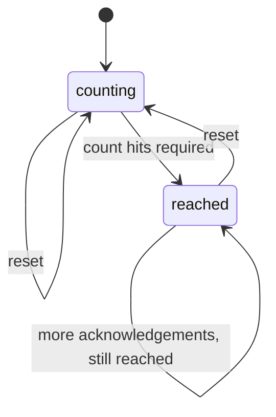
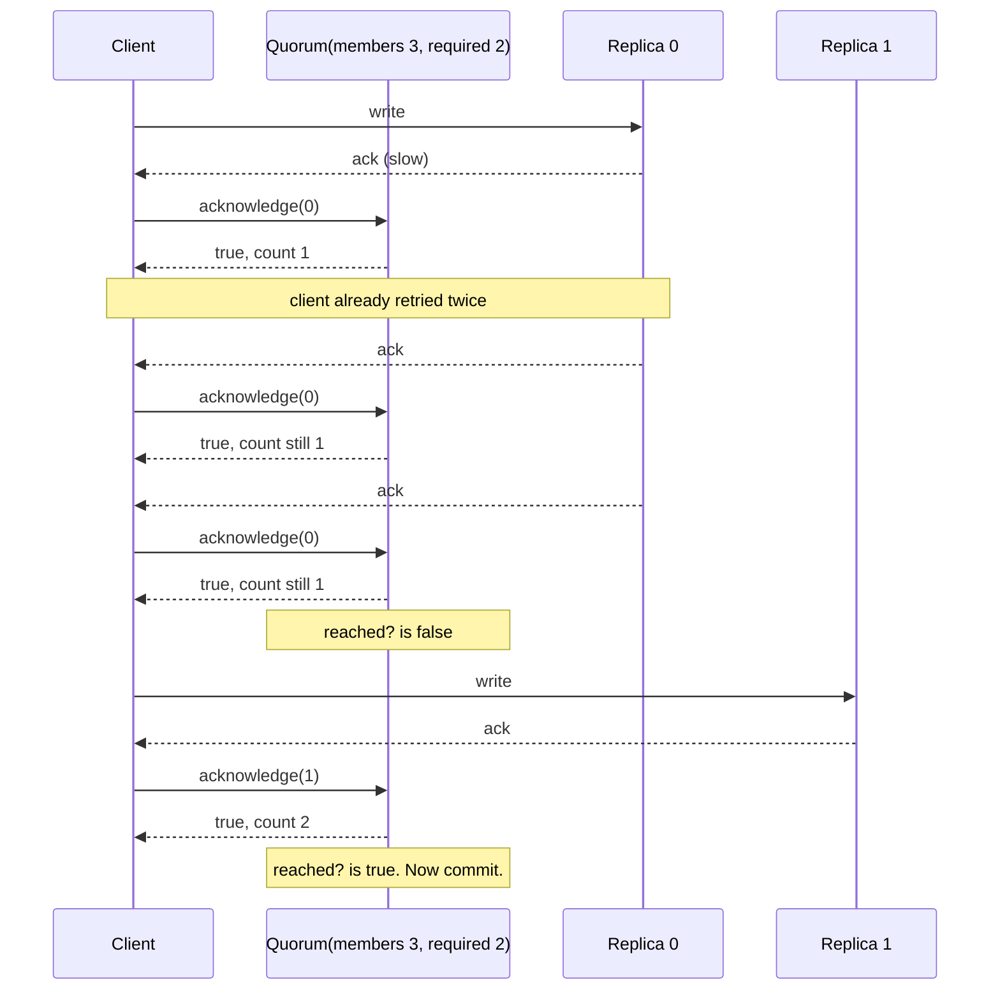

# QuorumMachines

> Three acknowledgements from the same replica are one vote, not three. 🗳️

A vote counter for Ruby that only counts heads. You tell it how many members there are and how many you need. It tracks *which* members have answered, not how many messages arrived, and tells you the moment enough distinct members are in. A second helper answers the sizing question before you deploy: do my read and write quorums overlap?

## Quick Start

```bash
gem 'quorum_machines'
```

```ruby
votes = QuorumMachines::Quorum.new(members: 3, required: 2)

votes.acknowledge(0)   # => true
votes.acknowledge(0)   # => true, but still one member
votes.count            # => 1
votes.reached?         # => false

votes.acknowledge(2)   # => true
votes.reached?         # => true
```

And before you pick those numbers at all:

```ruby
QuorumMachines.intersects?(members: 3, reads: 2, writes: 2)   # => true
QuorumMachines.intersects?(members: 3, reads: 1, writes: 2)   # => false
```

## A Message to the Resistance

So you replicated the writes. Three copies, commit when two say yes. You even wrote the counter yourself, because how hard can `acks += 1` be?

Then replica 0 got slow. Your client retried. Replica 0 answered the first request, and the retry, and the retry after that. Three acks. Counter says three. You committed a write that exists on exactly one machine, and that machine is the flaky one.

A quorum isn't a number of messages. It's a number of *members*. The counter has to remember who already spoke, ignore anyone speaking twice, and refuse anyone who isn't on the roster. That's the whole gem, and it's the part everyone gets wrong at 2 AM.

## Chapter 1: Stardate 2025.186, the AMS Gifford

> **AMS Gifford**, NCC-4216, *Gifford*-class quorum relay.
> Five repeated hails from one bridge are still one bridge.

The relay keeps a roster. When a ship hails, the relay marks that ship's name, not a tally. A captain who hails five times out of nerves is marked once. A ship not on the roster is politely ignored. When enough names are marked, the relay lights the board. What the fleet does with a lit board is the fleet's business.

On the bridge, an ensign offers:

```ruby
def replicated_write(payload)
  acks = 0
  replicas.each { |r| acks += 1 if r.write(payload, retries: 3) }
  commit! if acks >= 2
end
```

"That," says the comms officer, "is how one ship outvotes the fleet."

## The Flight Plan



And the night replica 0 answered three times:



## How the Relay Counts

### Members are seats, not messages

Members are numbered from zero. `acknowledge` returns `true` when the member is on the roster, whether or not it's new, and `false` when it isn't.

```ruby
votes = QuorumMachines::Quorum.new(members: 3, required: 2)

votes.acknowledge(1)   # => true
votes.acknowledge(3)   # => false, there is no seat 3
votes.count            # => 1
```

The return value answers "was that a real member?", not "did the count go up". Check `count` or `reached?` for the latter.

### Reaching the threshold

`reached?` flips the moment `count` meets `required` and stays up until you reset. Extra acknowledgements after that are harmless.

```ruby
votes = QuorumMachines::Quorum.new(members: 5, required: 3)
[4, 2, 4, 0].each { |member| votes.acknowledge(member) }

votes.count      # => 3
votes.reached?   # => true
```

For a majority, ask for `members / 2 + 1`.

### Starting the next round

```ruby
votes.reset
votes.count      # => 0
votes.reached?   # => false
```

One tracker per decision, reset between rounds, or build a fresh one. Both are cheap.

## Sizing Quorums Before You Ship

If a write is confirmed by `writes` members and a read consults `reads` members, a read is only guaranteed to see the latest write when the two sets must overlap. `intersects?` is that check.

```ruby
QuorumMachines.intersects?(members: 5, reads: 3, writes: 3)   # => true
QuorumMachines.intersects?(members: 5, reads: 2, writes: 3)   # => false
QuorumMachines.intersects?(members: 3, reads: 4, writes: 2)   # => false, can't read 4 of 3
```

Run it in a test against your configuration so nobody tunes `reads` down to 1 "for performance" and quietly turns your consistent store into an eventual one.

## The Rules of the Relay

- **Membership is 1 to 64** seats, indexed from zero. `MAX_MEMBERS` holds the ceiling.
- **`required` is 1 to `members`.** Zero, or more than the roster, raises `ArgumentError`.
- **Integers only.** A Float member or threshold raises `TypeError`. A negative member raises `RangeError`.
- **Off-roster is not an error.** Acknowledging a seat past the end returns `false` and changes nothing.
- **Frozen means frozen.** `freeze` the tracker and `acknowledge` or `reset` raise `FrozenError`.

## What You Think You're Doing vs Reality

### You Think: "Two out of three acks means two replicas have it."
### Reality: It means two messages arrived.

Retries, duplicate deliveries, and a proxy that replays on timeout all produce acks that look identical to the first one. Unless something remembers *who* answered, your quorum is counting network behavior, not durability.

## What's Yours

The relay counts. It does not know who is allowed to vote, whether a vote was forged, or what to do when the board lights up. Authenticate the sender before you call `acknowledge`, decide what a round means, and persist the outcome yourself. Counting votes is the easy part of consensus. It's just the part nobody should get wrong.

## License

MIT License. See [LICENSE.txt](LICENSE.txt) for details.

**Remember: Replica 0 will answer as many times as you ask. It still only gets one seat.**
