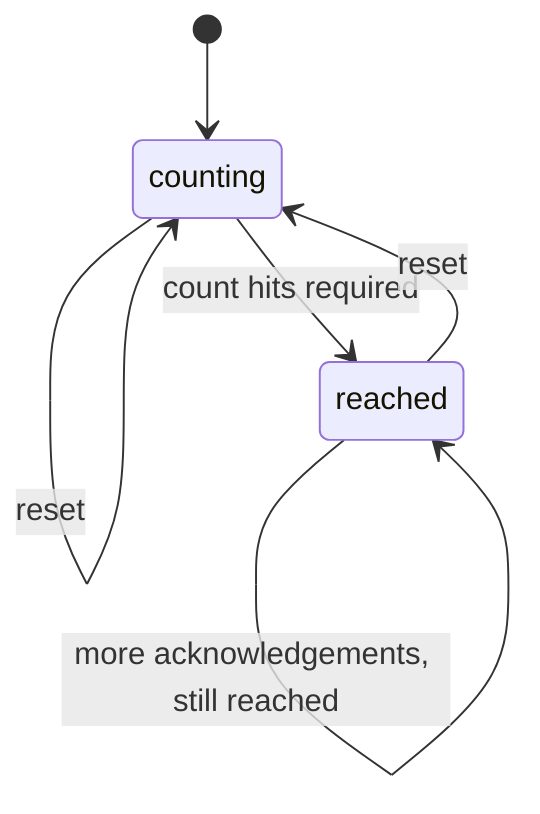
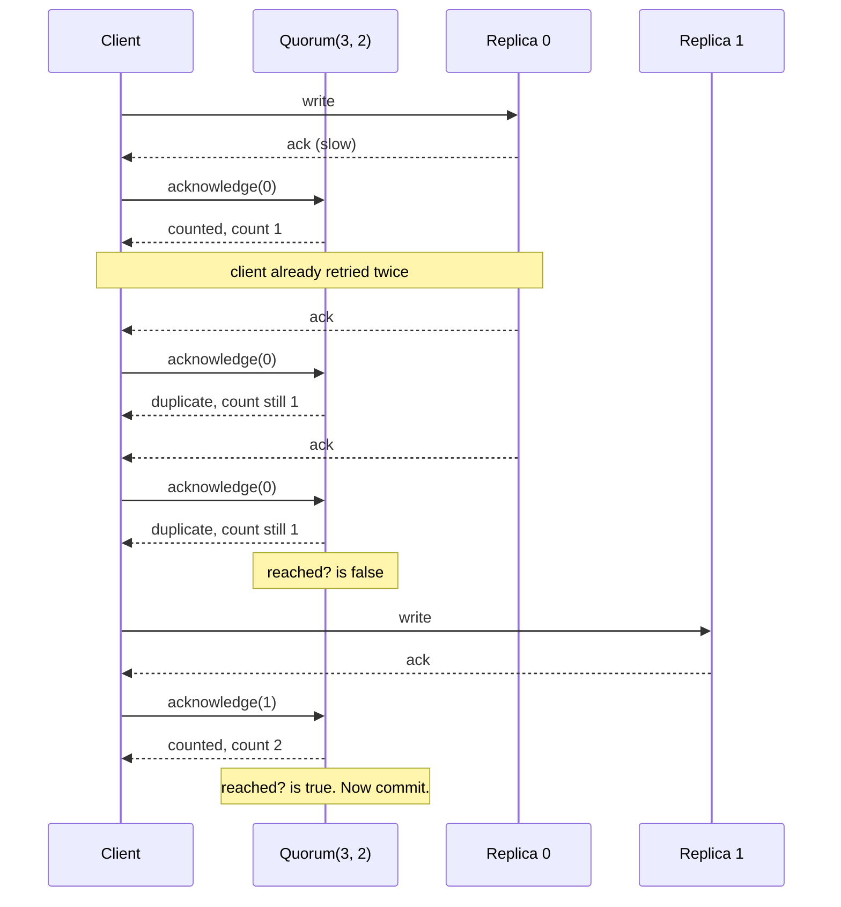

# QuorumMachines

> Three acknowledgements from the same replica are one vote, not three. 🗳️

A vote counter for Ruby that only counts heads. You tell it how many members there are and how many you need. It tracks *which* members have answered, not how many messages arrived, and tells you the moment enough distinct members are in. A second helper answers the sizing question before you deploy: do my read and write quorums overlap?

## Quick Start

```bash
gem 'quorum_machines'
```

```ruby
votes = QuorumMachines::Quorum.new(3, 2)   # members, required

votes.acknowledge(0)   # => :counted
votes.acknowledge(0)   # => :duplicate, still one member
votes.count            # => 1
votes.reached?         # => false

votes.acknowledge(2)   # => :counted
votes.reached?         # => true
```

And before you pick those numbers at all:

```ruby
QuorumMachines.intersects?(3, 2, 2)   # => true   (members, reads, writes)
QuorumMachines.intersects?(3, 1, 2)   # => false
```

## A Message to the Resistance

So you replicated the writes. Three copies, commit when two say yes. You even wrote the counter yourself, because how hard can `acks += 1` be?

Then replica 0 got slow. Your client retried. Replica 0 answered the first request, and the retry, and the retry after that. Three acks. Counter says three. You committed a write that exists on exactly one machine, and that machine is the flaky one.

A quorum isn't a number of messages. It's a number of *members*. The counter has to remember who already spoke, ignore anyone speaking twice, and refuse anyone who isn't on the roster. That's the whole gem, and it's the part everyone gets wrong at 2 AM.

## Chapter 1: Stardate 2025.186, the AMS Gifford

> **AMS Gifford**, NCC-4216, *Gifford*-class quorum relay.
> Five repeated hails from one bridge are still one bridge.

The relay keeps a roster. When a ship hails, the relay marks that ship's name, not a tally. A captain who hails five times out of nerves is marked once. A ship not on the roster is politely ignored. When enough names are marked, the relay lights the board. What the fleet does with a lit board is the fleet's business.

On the bridge, an ensign offers:

```ruby
def replicated_write(payload)
  acks = 0
  replicas.each { |r| acks += 1 if r.write(payload, retries: 3) }
  commit! if acks >= 2
end
```

"That," says the comms officer, "is how one ship outvotes the fleet."

## The Flight Plan



And the night replica 0 answered three times:



## How the Relay Counts

### Members are seats, not messages

Members are numbered from zero. `acknowledge` says exactly what happened: `:counted` for a member that is new this round, `:duplicate` for one that already answered, `:unknown_member` for a seat that isn't on the roster.

```ruby
votes = QuorumMachines::Quorum.new(3, 2)

votes.acknowledge(1)     # => :counted
votes.acknowledge(1)     # => :duplicate, nothing changed
votes.acknowledge(3)     # => :unknown_member, there is no seat 3
votes.count              # => 1
votes.acknowledged?(1)   # => true
```

`:counted` and `:duplicate` are both honoured: the member's vote is in. Only `:unknown_member` is a refusal.

### Reaching the threshold

`reached?` flips the moment `count` meets `required` and stays up until you reset. Extra acknowledgements after that are harmless.

```ruby
votes = QuorumMachines::Quorum.new(5, 3)
[4, 2, 4, 0].each { |member| votes.acknowledge(member) }

votes.count      # => 3
votes.reached?   # => true
```

For a majority, `Quorum.majority(members)` asks for `members / 2 + 1`:

```ruby
votes = QuorumMachines::Quorum.majority(5)
votes.required   # => 3
votes.members    # => 5
```

### Starting the next round

```ruby
votes.reset
votes.count      # => 0
votes.reached?   # => false
```

One tracker per decision, reset between rounds, or build a fresh one. Both are cheap. A reset forgets the round: a member that answered before it is `:counted` again after it.

## Sizing Quorums Before You Ship

If a write is confirmed by `writes` members and a read consults `reads` members, a read is only guaranteed to see the latest write when the two sets must overlap. `intersects?` is that check.

```ruby
QuorumMachines.intersects?(5, 3, 3)   # => true
QuorumMachines.intersects?(5, 2, 3)   # => false
QuorumMachines.intersects?(3, 4, 2)   # => false, can't read 4 of 3
```

Run it in a test against your configuration so nobody tunes `reads` down to 1 "for performance" and quietly turns your consistent store into an eventual one.

## The Rules of the Relay

- **Membership is 1 to 64** seats, indexed from zero. `Quorum::CAPACITY` holds the ceiling. It is the core's own `Quorum::CAPACITY`, the const generic `N` this gem compiles as 64, not a rule Ruby adds.
- **`required` is 1 to `members`.** Zero, more than the roster, or a roster past the ceiling raises `RangeError`.
- **Arguments are positional**, in the core's order: `Quorum.new(members, required)`, `Quorum.majority(members)`, `intersects?(members, reads, writes)`. There are no keywords and no defaults.
- **Integers only.** A Float member or threshold raises `TypeError`. A negative member raises `RangeError`. The message names the argument, so a Hash passed where `members` belongs says `members must be an Integer, not Hash`. `ArgumentError` only ever comes from Ruby itself, for arity.
- **Conversions come first.** Every argument is checked before the core is asked, and afterwards the binding only turns the core's answer into a symbol, so a raise never costs an acknowledgement.
- **A refusal is a symbol, never an exception, and changes nothing.** Acknowledging a seat past the roster answers `:unknown_member`.
- **A repeat is honoured.** The tracker keeps one mark per seat, so it knows a member already answered and says `:duplicate`. Nothing changes.
- **No ids, no clock.** Member indices are yours; the tracker issues nothing and never reads the time. No answer in the table below records a clock.
- **Frozen means frozen.** `freeze` the tracker and `acknowledge` or `reset` raise `FrozenError`.

### Every answer

A call that is honoured answers with a value. A call that is not honoured answers with a refusal symbol, the snake_case of the core's `Refusal` variant, and changes nothing. There is no catch-all symbol.

| Call | Honoured | Refusals | Records the clock |
| --- | --- | --- | --- |
| `Quorum.new(members, required)` | `Quorum` | none; a bad configuration raises `RangeError` | no |
| `Quorum.majority(members)` | `Quorum` | none; a bad configuration raises `RangeError` | no |
| `acknowledge(member)` | `:counted`, `:duplicate` (already acknowledged this round) | `:unknown_member` | no |
| `reset` | `nil` | none | no |
| `acknowledged?(member)` | `true`, `false` | none, a query | no |
| `reached?` | `true`, `false` | none, a query | no |
| `count`, `members`, `required` | `Integer` | none, a query | no |
| `QuorumMachines.intersects?(members, reads, writes)` | `true`, `false` | none, a query | no |

## What You Think You're Doing vs Reality

### You Think: "Two out of three acks means two replicas have it."
### Reality: It means two messages arrived.

Retries, duplicate deliveries, and a proxy that replays on timeout all produce acks that look identical to the first one. Unless something remembers *who* answered, your quorum is counting network behavior, not durability.

## What's Yours

The relay counts. It does not know who is allowed to vote, whether a vote was forged, or what to do when the board lights up. Authenticate the sender before you call `acknowledge`, decide what a round means, and persist the outcome yourself. Counting votes is the easy part of consensus. It's just the part nobody should get wrong.

## License

MIT License. See [LICENSE.txt](LICENSE.txt) for details.

**Remember: Replica 0 will answer as many times as you ask. It still only gets one seat.**
